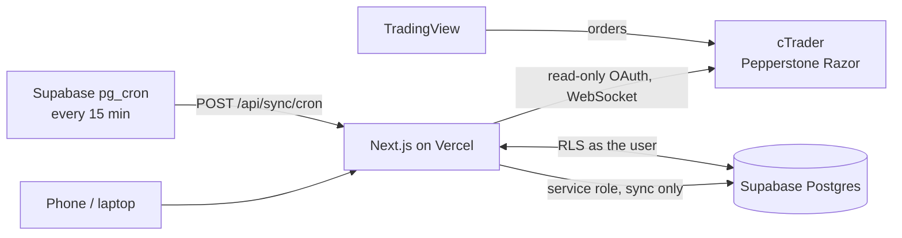

# Trading Journal

A private trading journal for a forex trader on **Pepperstone** (Razor account on cTrader) who charts and trades from **TradingView**. Trades sync automatically and read-only from cTrader every 15 minutes; everything can also be entered or corrected by hand.

- **Dashboard:** net P&L, win rate, profit factor, expectancy, average R, drawdown, equity curve, P&L calendar.
- **Journal per trade:** setup, emotions, rating, plan adherence, tags, notes, TradingView snapshots shown inline, screenshot uploads.
- **Pre-trade plans** with a personal checklist and live reward-to-risk.
- **Analytics** by session (Nairobi time), symbol, weekday, hour, setup, tag, emotion and holding time.
- **Behaviour flags:** revenge trades, tilt, overtrading, missing stops, and what each one cost.
- **Prop-firm limits:** daily and max loss tracking with warnings.
- **CSV import** with column mapping and duplicate detection; full CSV/JSON export.

Decisions and their reasons are in [docs/DECISIONS.md](docs/DECISIONS.md); questions still open with the trader are in [docs/OPEN-QUESTIONS.md](docs/OPEN-QUESTIONS.md).

## Architecture

```
apps/web          Next.js 16 (App Router, Cache Components) + Tailwind 4
packages/core     Framework-free domain logic: trade reconstruction, stats,
                  sessions, behaviour flags, prop-firm rules, CSV import/export
packages/ctrader  cTrader Open API client: OAuth + JSON over WebSocket
supabase/         Postgres migrations, RLS, pg_cron schedule, seed, pgTAP tests
```



Sync rebuilds each position from all of its executions, so scale-ins and partial closes add up across syncs. Journal fields are never touched by sync; broker fields edited by hand are locked against overwrite until reset.

## Local development

Requirements: Node 22+, pnpm 10, Docker.

```bash
pnpm install
pnpm db:start                         # local Supabase: migrations + fictional demo data
cp apps/web/.env.example apps/web/.env.local
# fill in the values printed by `pnpm exec supabase status`, plus:
#   TOKEN_ENCRYPTION_KEY=$(openssl rand -base64 32)
#   SYNC_SECRET=$(openssl rand -hex 32)
pnpm dev                              # http://localhost:3000
```

Sign in with the demo account `demo@journal.local` / `DemoTrader2026` (local seed only; every trade in it is fictional).

| Command | What it does |
|---|---|
| `pnpm check` | lint, typecheck and unit tests across the monorepo |
| `pnpm build` | production build |
| `pnpm exec supabase test db` | RLS and MFA tests (pgTAP) |
| `pnpm --filter @tj/web test:e2e` | Playwright end-to-end tests (needs a build and the local database) |
| `pnpm db:reset` | rebuild the local database from migrations and seed |
| `pnpm db:types` | regenerate `database.types.ts` after a migration |

## Deploying

1. **cTrader app.** Register at <https://openapi.ctrader.com>. Redirect URI: `https://<your-domain>/api/ctrader/callback`. Approval can take a few days, so start here.
2. **Supabase project.** Create it, then:
   - Authentication → disable sign-ups, enable TOTP MFA, set the site URL to the app's URL.
   - Create the trader's user (Authentication → Users → invite).
   - SQL editor, once:
     ```sql
     select vault.create_secret('https://<your-domain>', 'app_url');
     select vault.create_secret('<SYNC_SECRET value>', 'sync_secret');
     ```
3. **Vercel project.** Import the GitHub repo, set Root Directory to `apps/web`, and add every variable from `apps/web/.env.example`. Production deploys from `main`; each PR gets a preview.
4. **GitHub.** Add an environment `production` with secrets `SUPABASE_ACCESS_TOKEN`, `SUPABASE_DB_PASSWORD` and `SUPABASE_PROJECT_ID`. After CI passes on `main`, the **Deploy database** workflow applies new migrations.

## CI/CD

Every PR and push to `main` runs: lint, typecheck, unit tests, build; Supabase migrations from scratch, schema lint, RLS/MFA tests, generated-types drift check, Playwright end-to-end tests; gitleaks secret scan; `pnpm audit`; CodeQL. Dependabot opens weekly dependency updates.

## Security

- cTrader access is **read-only** (`accounts` scope). Tokens are AES-256-GCM encrypted, bound to their row, and readable only server-side.
- Row Level Security on every table; restrictive policies deny everything to a password-only session once 2FA is enrolled.
- No public sign-up; generic login errors; login audit log.
- Zod validation on every server action and route; image uploads checked by type, size and file signature; CSV exports neutralise spreadsheet formulas.
- Strict security headers (CSP, HSTS, frame-ancestors none, nosniff, referrer and permissions policies).

See ADRs 007 and 011 for the reasoning and trade-offs.
